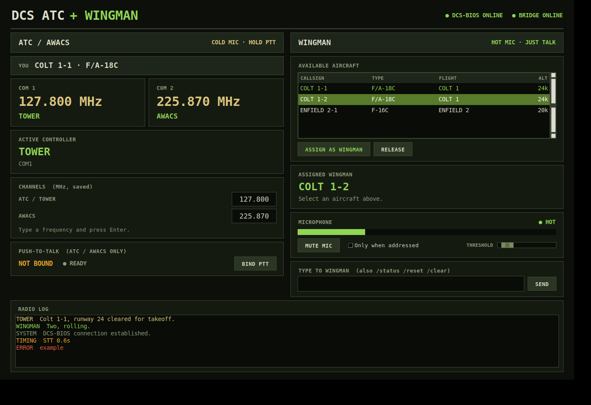

# DCS ATC + Wingman

### [⬇ Download the installer](../../releases/latest)
Get **`DCS_ATC_Setup.exe`** from the latest release and run it - no Python, no building. (The rest of this page is for developers.)

Installation Tutorial: https://youtu.be/nb0dCKNpnnQ

---

Voice-controlled **ATC, AWACS / GCI and an AI wingman** for [DCS World](https://www.digitalcombatsimulator.com/).
Talk on your radio, get realistic replies. Everything runs **locally** on your PC: speech recognition
(Whisper), the language model (Ollama) and the voices (Piper).



*(UI preview with sample data.)*

## What it does

| | ATC / AWACS / GCI | Wingman |
|---|---|---|
| Mic | **Cold** - hold your PTT button | **Hot** - just talk |
| Voice | Heavy radio effects | Cleaner "intercom" effects |
| How it answers | Procedures + LLM wording | Persona + order parser |

* **ATC and AWACS on your real radio.** The app reads which frequency COM1 / COM2 is tuned to (through
  DCS-BIOS) and answers as Tower or AWACS when you are on their channel. Both channels are set in the app
  and remembered.
* **AWACS picture.** A Lua bridge inside DCS sends the air picture to the app, so AWACS / GCI can give
  bogey dopes, pictures and tasking.
* **Wingman.** Pick any AI aircraft from the roster, then give orders by voice. Orders go back into DCS
  through the bridge; the wingman calls out shots, takeoffs, landings, kills and radar contacts.
* **One speaker queue.** Voices never talk over each other and the hot mic is deaf while anything is
  being spoken.
* **Sets itself up.** The app installs its DCS mission loader, offers to install DCS-BIOS if it is missing,
  and keeps DCS's `MissionScripting.lua` open to the bridge (see [How it hooks into DCS](#how-it-hooks-into-dcs)).

## Requirements

* Windows 10 / 11, 64-bit
* DCS World
* [Ollama](https://ollama.com) with a model pulled, e.g. `ollama pull gemma3:12b`
  (a GPU helps a lot; a smaller model such as `gemma3:4b` is faster - see Configuration)
* A microphone, ideally a headset so the wingman does not hear your speakers

## Install

1. Download **`DCS_ATC_Setup.exe`** from the [latest release](../../releases/latest) and run it.
2. Start **DCS ATC** from the Start Menu.
3. On first start it may ask to:
   * install DCS-BIOS (downloaded from the official DCS-BIOS releases), and
   * fix `MissionScripting.lua` (Windows asks for administrator permission if DCS is in Program Files).
4. Start DCS once if you have never run it, then restart the app so it can set up its loader.
   **Restart DCS** after anything above changed something.
5. Wait for "Ready" in the radio log before the first transmission (models load in the background).

Settings, recordings and `log.txt` live in `%APPDATA%\DCS ATC`.

## Using it

* **BIND PTT** - choose the button you hold to talk to ATC / AWACS.
* **CHANNELS** - type the Tower and AWACS frequencies (MHz) and press Enter. Tune that frequency on
  COM1 or COM2 in the cockpit and hold PTT.
* **Wingman** - select an aircraft in the roster, press **ASSIGN AS WINGMAN**, then just talk.
  Use the mute button, "only when addressed" and the threshold slider if the hot mic picks up too much.

## Configuration

`%APPDATA%\DCS ATC\settings.json` (new keys are added automatically). Common ones:

| Key | Meaning |
|---|---|
| `channels.tower`, `channels.awacs` | frequencies in MHz (also editable in the window) |
| `llm.atc_model`, `llm.wingman_model` | Ollama models, e.g. `gemma3:4b` for speed |
| `tts.atc_model`, `tts.wingman_model` | Piper voice names |
| `audio.input_device`, `audio.output_device` | sounddevice index or name (`null` = default) |
| `dcs.auto_install_hook` | keep the DCS mission loader installed |
| `dcs.auto_install_bios` | offer to install DCS-BIOS when missing |
| `dcs.auto_fix_mission_scripting` | keep `MissionScripting.lua` open to the bridge |

More detail in [docs/NOTES.md](docs/NOTES.md).

## How it hooks into DCS

* **Loader hook** - the app copies `wingman_loader.lua` into `Saved Games\DCS*\Scripts\Hooks`, which starts
  `wingman_bridge.lua` in every mission automatically (no Mission Editor step).
* **DCS-BIOS** - provides the radio frequencies. Installed to `Scripts\DCS-BIOS` plus a line in `Export.lua`.
* **`MissionScripting.lua`** - DCS blocks `require` / `package` / `loadlib` for mission scripts, which the
  bridge needs to load `lua-socket`. The app comments out those three lines (each marked `-- [DCS ATC]`),
  re-checks on every start because DCS updates restore them, and the uninstaller puts them back.
  **This relaxes DCS's mission sandbox slightly - only run missions you trust.** Servers that enforce
  file-integrity checks may reject the modified file. Opt out with `dcs.auto_fix_mission_scripting: false`.

UDP ports used locally: 5015 AWACS picture, 5016 telemetry, 5017 orders, 5018 events.

## Troubleshooting

* Check `%APPDATA%\DCS ATC\log.txt` (the previous run is `log_previous.txt`).
* Nothing happens in DCS after an update: DCS probably restored `MissionScripting.lua` - start the app
  and accept the fix.
* Slow replies: the radio log shows a dim `TIMING` line per stage. The LLM is usually the slow part; use a
  smaller model and check `ollama ps` shows the model on the GPU.

## Run from source

```
python -m venv .venv
.venv\Scripts\activate
pip install -r requirements.txt
python fetch_models.py      # optional: downloads the Piper voice next to main.py
python main.py
```

Python 3.10-3.12. From source, settings and logs stay in the project folder.

Quick tests (no heavy dependencies): `python tests/test_channels.py` and the other `tests/test_*.py`
files for paths, the DCS loader, `MissionScripting.lua` and DCS-BIOS setup.

## Build the installer

Needs Python and [Inno Setup 6](https://jrsoftware.org/isinfo.php). Run `build_installer.bat`: it downloads the
models, builds the exe with PyInstaller (`DCS_ATC.spec`) and wraps it with Inno Setup
(`installer\DCS_ATC.iss`) into `installer_output\DCS_ATC_Setup.exe`.

Pushing a tag such as `v1.0.0` runs the same build on GitHub Actions (`.github/workflows/build.yml`) and
attaches the installer to the release.

## Third-party components

DCS ATC builds on other projects, each under its own licence:

* [DCS-BIOS](https://github.com/DCS-Skunkworks/dcs-bios) - downloaded from its official releases, not redistributed here
* [Piper](https://github.com/OHF-Voice/piper1-gpl) - text to speech (GPL-3.0-or-later); voices are licensed individually
* [faster-whisper](https://github.com/SYSTRAN/faster-whisper) / OpenAI Whisper - speech recognition
* [Ollama](https://ollama.com) and the language model you choose - models have their own terms
* numpy, scipy, sounddevice, soundfile, pygame

DCS ATC is an independent fan project, not affiliated with or endorsed by Eagle Dynamics. DCS World is a
trademark of Eagle Dynamics SA.
